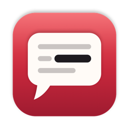
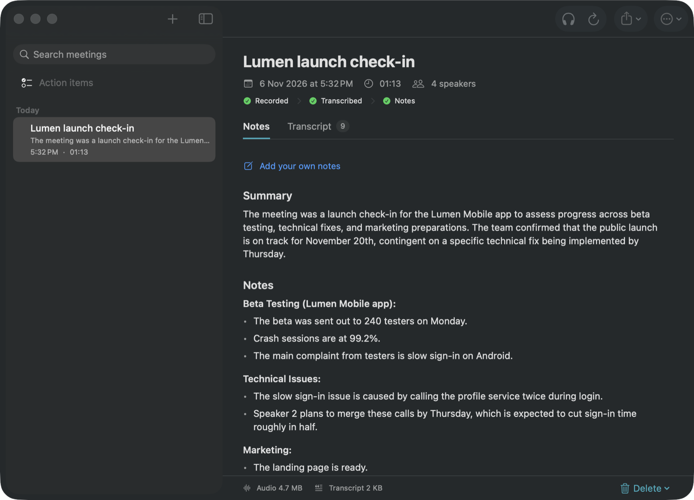
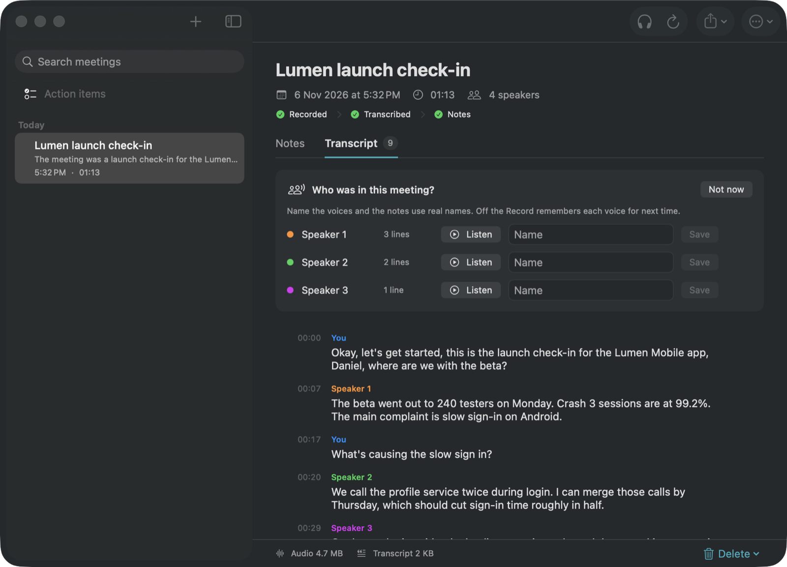
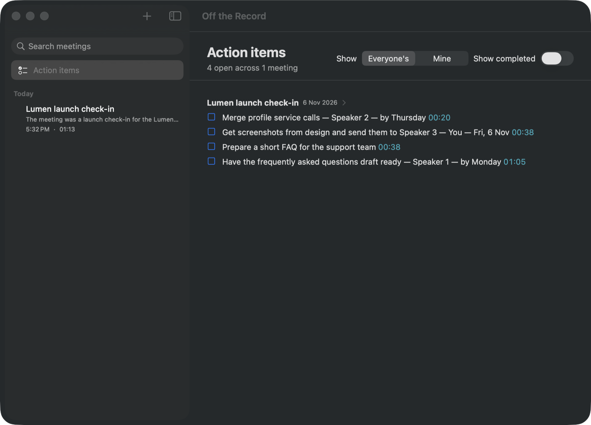
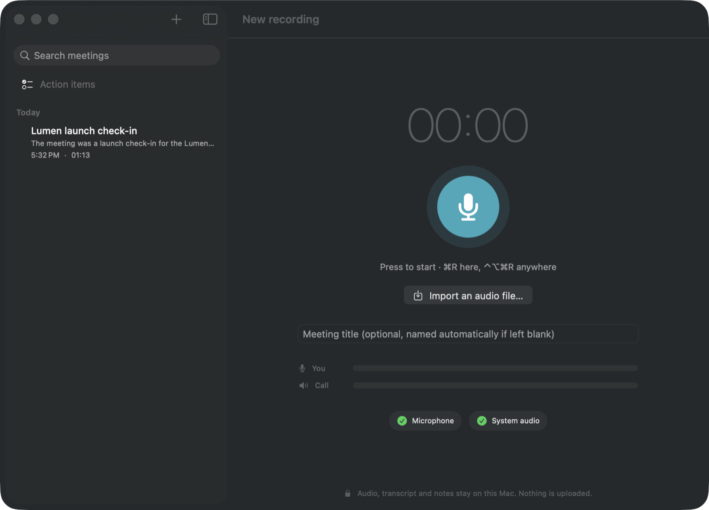
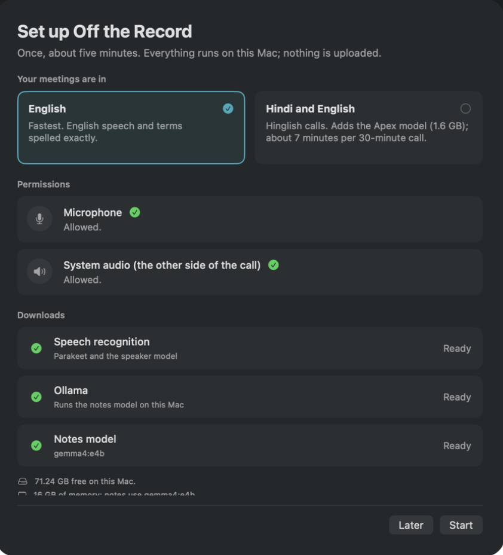

<p align="center">
  
</p>

<h1 align="center">Off the Record</h1>

<p align="center">
  <b>Meeting notes that never leave your Mac.</b><br>
  Records both sides of a call, transcribes it on the Neural Engine and writes the notes with a local
  language model. Works for English and for Hindi–English (Hinglish) meetings.
</p>

<p align="center">
  <a href="https://github.com/jatsharma/off-the-record/releases/latest"></a>
</p>

<p align="center">
  
  
  
  <a href="LICENSE"></a>
  
</p>

<p align="center">
  
</p>

## Why Off the Record

- **Private by design.** Audio, transcripts and notes stay on your Mac. No account, no cloud, no telemetry.
  The only network use is the one-time download of the models.
- **No bot in your call.** It records your microphone and the call's audio straight from macOS, so it
  works with Zoom, Meet, Teams, Slack, WhatsApp or anything else that plays sound.
- **Built for Hinglish.** Most transcription tools turn Hindi into English-sounding nonsense. Off the
  Record reads Hindi with a Hinglish model and English terms and numbers with an English one.
- **Notes you can check.** Decisions and action items carry the time they were said; click a time in the
  notes to hear that moment. Action items are verified against the transcript before they are listed.
- **It learns your words.** Fix a misheard name once, in the transcript or the notes, and later meetings
  get it right.

## Features

| | |
| --- | --- |
| **Record** | One click, ⌘R, ⌃⌥⌘R from any app, or the menu bar. Your side and the call are kept apart, and the call's echo is removed from your microphone. Pause and resume, live captions, and a box to type your own notes while you talk. |
| **Transcribe** | Parakeet for English, or the Mix engine for Hinglish (Apex for the Hindi, Parakeet for English terms and numbers). Speakers are separated and remembered: name a voice once and it is recognised in later meetings. |
| **Notes** | Summary, notes by topic, decisions and checked action items, written by Gemma 4 through Ollama. Templates for stand-ups, one-on-ones, interviews and client calls. Your typed notes come first and the model fills in the details. |
| **Edit** | Double-click any line of the notes to change it. Word fixes are remembered for later meetings. |
| **Find** | Search across titles, notes and transcripts. All open action items in one place, filtered to yours. |
| **Import** | Drop in recordings you already have: WAV, MP3, M4A, AIFF, CAF or FLAC. |

<table>
  <tr>
    <td width="50%"><br><sub>Transcript with speakers, and a prompt to name them</sub></td>
    <td width="50%"><br><sub>Action items across meetings, each linked to its moment</sub></td>
  </tr>
  <tr>
    <td width="50%"><br><sub>Record, or import an audio file</sub></td>
    <td width="50%"><br><sub>One-time setup: language, permissions, downloads</sub></td>
  </tr>
</table>

## Install

1. Download **Off the Record &lt;version&gt;.dmg** from [Releases](https://github.com/jatsharma/off-the-record/releases/latest),
   open it and drag **Off the Record** into Applications.
2. Open it. Builds are not notarized by Apple yet, so the first time macOS says it cannot check the app:
   click **Done**, open **System Settings → Privacy & Security**, scroll down and click **Open Anyway**
   next to Off the Record. You do this once; later versions open normally.
   Before you click **Open Anyway**, you can check that the download is the one published here: the
   release notes list its SHA-256, which `shasum -a 256 ~/Downloads/Off\ the\ Record*.dmg` should match.
3. The setup assistant asks what language your meetings are in, gets the microphone and system-audio
   permissions, lets you turn on screen reading (optional, off by default), and downloads what it
   needs, once:

| Download | Size | When |
| --- | --- | --- |
| Speech models (Parakeet and the speaker model) | 520 MB | always |
| Hinglish model ([Apex, Core ML](https://huggingface.co/jatsharma/whisper-hinglish-apex-coreml)) | 1.6 GB | Hindi and English meetings |
| [Ollama](https://ollama.com), the official build, checksum-verified | 190 MB | only if Ollama is not installed |
| Notes model: Gemma 4 (`gemma4:e4b`, or `gemma4:e2b` on Macs with less than 16 GB) | 6.6 GB / 4.6 GB | always |

**Requirements:** macOS 15 or later on Apple Silicon. 16 GB of memory recommended; 8 GB works with the
lighter notes model.

## Privacy

- Everything is processed on your Mac: recording, transcription, speaker separation and the notes.
- Network use is limited to downloading models from Hugging Face, the Ollama runtime from GitHub and the
  notes model from the Ollama registry. Nothing is uploaded.
- Optional, off by default: while recording, the app can read text on your screen every 20 seconds
  (only when the screen changed) so names on shared slides are spelled correctly. Once the meeting is
  processed, only the names and terms found are kept, not the screen text. Turn it on during setup or
  in Settings → Vocabulary.
- Your data lives in `~/Library/Application Support/Off the Record`: one SQLite database and one audio
  file per meeting. Delete a meeting, its audio or its transcript at any time; Settings → Storage
  clears the audio of older meetings in one click.
- The files are not encrypted by the app. Turn on FileVault (System Settings → Privacy & Security) so
  they are encrypted on disk, and keep in mind that other apps you run can read your home folder.
- Links in notes open only after you have seen the full address; links to files or other apps do not
  open at all.
- Settings → Notes → Advanced can point the app at an Ollama server on another computer. The app warns
  when it does: transcripts then go to that server.

## How it works

```
 microphone ─┐                       ┌─ You ──────────────┐
             ├─ two-channel WAV ─────┤                    ├─ transcript ─ clean-up ─ notes ─ action items
 call audio ─┘   (echo removed)      └─ diarized speakers ┘   (Parakeet / Apex)   (Gemma 4 via Ollama)
```

The details (the echo gate, the Mix engine, why the transcript goes first in the prompt, where each
file lives) are in [docs/how-it-works.md](docs/how-it-works.md).

## Build from source

Needs Xcode 26 and [XcodeGen](https://github.com/yonaskolb/XcodeGen) (`brew install xcodegen`).

```bash
git clone https://github.com/jatsharma/off-the-record.git
cd off-the-record
make run        # fetches FluidAudio, generates the Xcode project, builds and opens the app
make test       # unit tests
```

`make gen` generates `NotesApp.xcodeproj` to open in Xcode. Debug builds accept developer launch
options: `--import <file>`, `--auto-record <seconds>`, `--summarize <meeting id>`,
`--download-model apex`, `--screenshots <folder>`, `--diagnostics <file>`.

Package versions are pinned in `Package.resolved`, FluidAudio to one commit, and the Hinglish models to
one Hugging Face commit each. `make update-packages` moves the packages to the newest versions
`project.yml` allows.

The unit tests cover the notes line parser, word-fix learning, the action-item checks and the echo
gate. They run inside the app as a bare process, so your meetings and settings are not touched.
GitHub Actions runs them and a Release build on every push and pull request.

**Signing.** macOS ties the microphone and system-audio permissions to the app's signature, so ad-hoc
builds have to be allowed again after every build. Create a local signing certificate once:

```bash
sh scripts/make-signing-cert.sh
```

`make` picks the best identity automatically: a Developer ID, then that certificate, then ad-hoc.

**Releases.**

```bash
make dmg                                  # signed Release build → dist/Off the Record <version>.dmg
NOTARY_PROFILE=<profile> make notarize    # with a Developer ID: notarize and staple
```

## Contributing

Issues and pull requests are welcome. When reporting a bug, include **Help → Copy Diagnostics** from the
app: versions, settings and recent errors, without any meeting content. For larger changes, open an issue
first so we can agree on the approach.

## License

[MIT](LICENSE). Off the Record builds on FluidAudio, WhisperKit, GRDB, Ollama and openly licensed models
(Parakeet, pyannote and WeSpeaker, Silero VAD, Apex, Tara and Gemma); see
[THIRD_PARTY_NOTICES.md](THIRD_PARTY_NOTICES.md), also under Help → Acknowledgements in the app.
